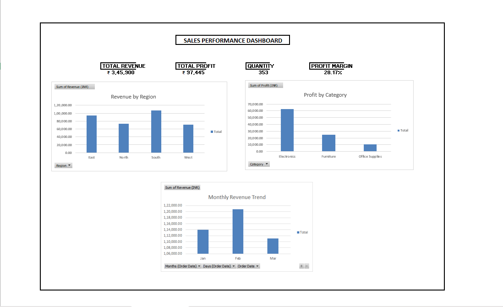

# Sales Performance Analysis Dashboard

## Project Overview
This project analyzes fictional sales data using Microsoft Excel to understand revenue, profit, regional performance, and monthly sales trends.

## Tools Used
- Microsoft Excel
- PivotTables and PivotCharts
- Excel formulas
- KPI Dashboard

## Key Performance Indicators
- Total Revenue: ₹3,45,900
- Total Profit: ₹97,445
- Quantity Sold: 353
- Profit Margin: 28.17%

## Key Findings
- South generated the highest revenue among the regions.
- Electronics generated the highest profit among the categories.
- February had the highest monthly revenue.

## Dashboard

## Dataset
The dataset contains fictional sales transactions from January to March 2026.

**Disclaimer:** This is a practice project using fictional data, not actual company sales.

## Author

Shravan  
GitHub: [shavv123](https://github.com/shavv123)

